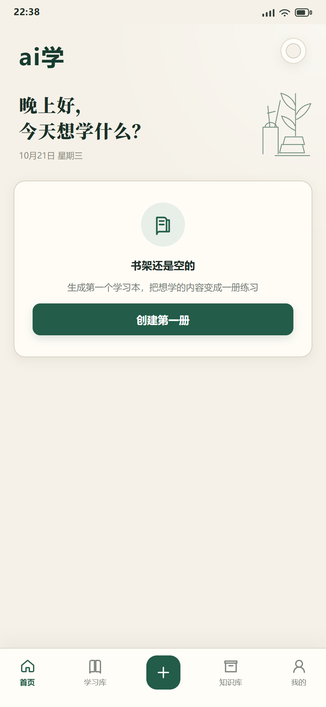
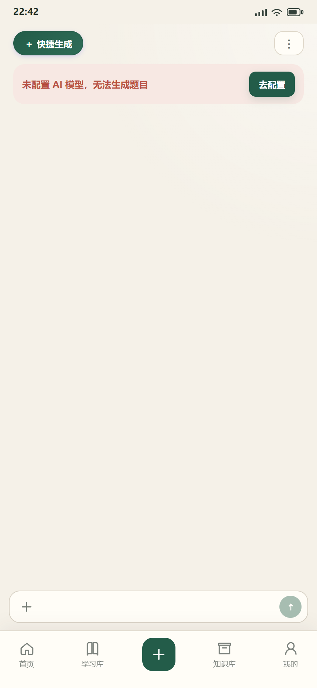
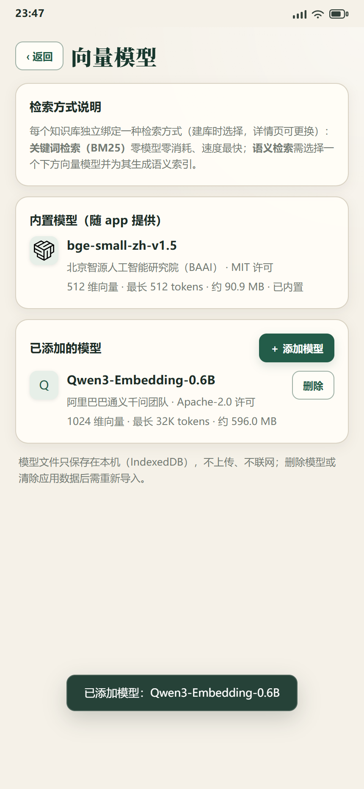

# ai学（Aixue）

> 本地优先的 AI 出题 + 刷题学习应用：用自然语言把自己的主题或资料变成题包，再配合间隔复习、错题本与本地知识库语义检索来刷题。**所有学习数据保存在设备本地。**

Aixue is a local-first quiz generator and study app built with React + Capacitor. Describe what you want to learn, let any OpenAI-compatible LLM draft the questions, then drill yourself with spaced repetition. All user data stays on the device (IndexedDB) — there is no backend service.

## 截图

<p align="center">
  
  
  
</p>

## 功能

- **对话式生题**：用自然语言描述主题、题量、题型与难度，AI 逐轮收集需求并确认方案后生成；支持快捷生成弹窗、流式逐题上屏、批次并发调度与限流自适应、中断续跑与缺口补齐；生成结果先进入预览校验，异常题可单独编辑或一键剔除。
- **九种题型**：单选、多选、判断、填空、匹配、排序、简答、案例分析、论文；填空支持同义词组，匹配/排序部分给分，主观题自评。
- **学习与复习**：学习本（题包）与分类管理、章节顺序/随机刷题、成绩复盘与逐题解析、错题本（标记已掌握/移出/重练）、今日复习（SRS 间隔重复）。
- **本地知识库**：导入 txt/md/csv/代码/docx/xlsx/odt 或直接写文字笔记，自动清洗分块；支持 **BM25 关键词检索**与**语义检索**（内置 bge-small-zh-v1.5，可按需导入 Qwen3-Embedding-0.6B），带召回测试与全屏阅读器（目录/书签/想法、夜间模式、字号与四种背景、三种翻页动画）。
- **AI 供应商**：内置 9 家 OpenAI 兼容适配器（DeepSeek、智谱 AI、腾讯混元、Kimi、MiniMax、OpenAI 兼容、小米 MiMo、火山方舟、通义千问），支持自定义 API 地址、拉取模型列表、连通性测试、思考开关与峰谷计价；新增供应商只需在 `src/ai/providers/manifest.ts` 登记一条。
- **用量统计**：按时间窗、板块、模型、按天统计 Token 与花费，含缓存命中率。
- **导入与导出**：JSON / Markdown 题包导入（含重复检测与坏题明细）、学习本导出 Markdown、知识库资料导出、全量数据备份与恢复（**备份不包含 API Key**）。
- **Android 原生能力**：Capacitor 打包；适配四条安全区、软键盘、返回手势（子页回宿主、主页双击退出）、长任务屏幕常亮。
- **其他**：5 色换肤（含暗色）、运行日志查看与一键导出。

## 技术栈

| 层 | 选型 |
|---|---|
| 界面 | React 19 + TypeScript + Vite 8（自研 CSS 主题：[src/theme-v2.css](src/theme-v2.css)） |
| 状态 | Zustand 5 |
| 存储 | IndexedDB（[idb](https://github.com/jakearchibald/idb) 封装：[src/db/index.ts](src/db/index.ts)） |
| 端侧推理 | onnxruntime-web（SIMD wasm）+ 自研 tokenizer，内置 bge、可选模型本地导入，离线推理 |
| 打包 | Capacitor 8（Android，包名 `com.aixue.app`） |
| 测试 | Vitest（fake-indexeddb 隔离数据库） |

## 目录结构

```text
src/
  ai/                  模型调用、适配器与解析（providers/ 供应商清单、embed/ 端侧向量模型）
  components/          复用组件（生题方案卡、召回测试、题目卡等）
  db/                  IndexedDB 封装与版本迁移
  pages/               页面（首页/学习库/生成/刷题/知识库/阅读器/设置等 18 个）
  services/            业务服务（generation/ 生题、kb/ 知识库、learning/ 学习、io/ 导入导出、quiz/ 判分）
  stores/              Zustand store
  workers/             生题并发工作线程
scripts/               构建准备、密钥扫描、Android 环境检查、测试数据生成
android/               Capacitor Android 工程
docs/                  对外文档（内部过程文档在 docs/internal/，不入库）
public/models/         内置向量模型放置目录（仅 bge 随包分发，模型文件不入库）
```

## 快速开始

环境要求：Node 20.19+ 或 22.12+（Vite 8 的引擎要求；开发使用 Node 24）、npm 10+。

```bash
npm ci                  # 安装依赖
npm run dev             # 开发服务器，默认 http://localhost:5173
npm run build           # 生产构建（tsc + vite build）→ dist/
npm test                # 单元测试（Vitest）
npm run secret:scan     # 密钥扫描门禁（需先安装 gitleaks，fail-closed）
```

指定端口启动：`npm run dev -- --host 127.0.0.1 --port 5174`。

`dev` 与 `build` 会先执行 `scripts/copy-ort.mjs`，把 onnxruntime-web 的 wasm 后端准备到 `src/assets/ort-wasm/`（该目录是构建产物，不随仓库分发）；构建完成后 `vite.config.ts` 的插件再把它复制到 `dist/assets/ort-wasm/`，保证 Capacitor WebView 里 wasm 与 `ort.min.mjs` 同层加载。

## 配置 AI 模型

打开应用内「我的 → AI 设置」，选择供应商并填入**你自己的** API Key、模型名与 API 地址即可：

- API Key 只保存在设备本地 IndexedDB，不会写入代码、不会随数据备份导出。
- 支持自定义 API 地址（保存前会做协议与主机校验，并明确提示 Key 将被发送到哪个地址）。
- 浏览器开发环境下直连厂商 API 会遇到 CORS，因此 dev server 提供了一个**仅开发环境**使用本地代理 `/__ai`：带厂商网关 host 精确白名单（由 `src/ai/providers/manifest.ts` 单源推导）、拒绝内网/环回地址与裸 IP、限制请求体与并发、逐跳校验重定向，防 SSRF。可用 `AI_PROXY_ALLOW_HOSTS` 追加自定义 host。打包后的 Android 应用走 WebView 直连，不需要代理。

## 向量模型

知识库的语义检索使用端侧 ONNX 向量模型，分两种来源：

- **内置（默认）**：bge-small-zh-v1.5（约 95 MB，MIT 许可，BAAI）随 app 分发，开箱即用。
- **可选导入**：Qwen3-Embedding-0.6B（约 614 MB，Apache-2.0，阿里通义千问）体积较大，不随 app 分发。需要时从 GitHub Releases 下载 `qwen3-embedding-0.6b.aixue-model`，在「我的 → 向量模型 → 添加模型」选择该文件导入（只保存到本机，可随时删除）。

模型包格式、打包脚本（`npm run pack:model`）与发布步骤见 [docs/模型包与导入.md](docs/模型包与导入.md)。即使不导入任何模型，也可以选择 **BM25 关键词检索**，其余功能不受影响。

## Android 构建

```bash
npm run android:sync      # 构建 web 产物并同步到 android/
npm run android:apk       # debug APK（assembleDebug）
npm run android:personal  # 个人自装包（assemblePersonal，固定 debug 签名）
npm run android:release   # 正式 release（需先配置签名环境变量，缺一会 fail-closed）
```

签名变量为 `AIXUE_KEYSTORE_PATH` / `AIXUE_KEYSTORE_PASS` / `AIXUE_KEY_ALIAS` / `AIXUE_KEY_PASS`（环境变量或 `android/gradle.properties`）。详见 [docs/ANDROID_RELEASE.md](docs/ANDROID_RELEASE.md)。

## 已知限制

- **正式 release 需要自行准备 Android SDK、JDK 17+ 与 keystore**（`npm run android:release` 会先跑环境前置检查，缺签名要素即 fail-closed）。
- 语义检索模型不随仓库分发（见上一节）。
- 应用没有自建服务端：数据只在本机浏览器/应用内，卸载应用或清除站点数据会一并删除（请先使用数据管理里的导出/备份）。
- 开发模式下包含仅供调试的模拟手机外框与本地日志落盘中间件，生产构建不包含。
- 运行所需的 ONNX wasm 后端与内置模型都需要在首次使用时加载，桌面浏览器首次进入向量检索会有明显等待（需 cross-origin isolation，dev server 已自动补 COOP/COEP 头）。

## 隐私与安全

- [PRIVACY.md](PRIVACY.md)：数据本地保存、无遥测、无自建服务端；只有在调用 AI 时才会把所选内容发送给你配置的模型厂商。
- [SECURITY.md](SECURITY.md)：漏洞上报方式与密钥处理规范。

## 参与贡献

欢迎提交 Issue 与 Pull Request。开始前请阅读：

- [CONTRIBUTING.md](CONTRIBUTING.md)：开发环境、测试命令与提交前自检；
- [CODE_OF_CONDUCT.md](CODE_OF_CONDUCT.md)：社区行为准则；
- [SECURITY.md](SECURITY.md)：安全漏洞请走私下渠道，不要公开提交；
- [CHANGELOG.md](CHANGELOG.md)：版本变更记录。

## 许可证

[MIT](LICENSE) © 2026 ai学 (Aixue) contributors

第三方依赖与模型的许可声明见 [THIRD-PARTY-NOTICES.md](THIRD-PARTY-NOTICES.md)。

## 文档

| 文档 | 说明 |
|---|---|
| [docs/本地部署与模型准备.md](docs/本地部署与模型准备.md) | 本地运行、向量模型放置与校验、开发代理说明 |
| [docs/ANDROID_RELEASE.md](docs/ANDROID_RELEASE.md) | Android 签名、构建与发布步骤 |
| [docs/AI知识库原理.md](docs/AI知识库原理.md) | 知识库分块、索引与检索原理 |
| [docs/知识库索引与检索说明.md](docs/知识库索引与检索说明.md) | 索引生成与检索通道说明 |
| [docs/九题型导入示例.md](docs/九题型导入示例.md) | 题包 JSON / Markdown 导入格式示例 |
| [docs/模型包与导入.md](docs/模型包与导入.md) | 向量模型包格式、打包、发布与导入说明 |